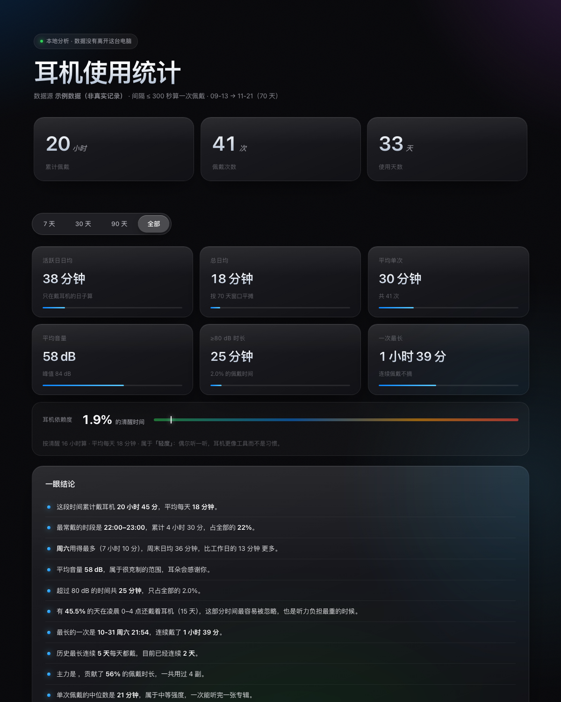

> 拖入 `export.zip` 就地出报告的网页版：https://clear-train.github.io/podsstats-lite/

# PodsStat

从 Apple 健康的「耳机音量」记录里，统计你到底戴了多久、什么时候戴、开多大声。

PodsStats 的核心逻辑就是这一件事：把健康 App 每隔一两分钟写一条的音频暴露样本，按时间连续性拼成「一次佩戴」，再做聚合。这个项目把它完整实现了一遍，附带终端报告、可交互的 HTML 报告、坐标数据导出，以及一个 iPhone App 的源码。

```
./.build/release/podsstat ~/Downloads/导出.zip --open
```

---

## 一、数据从哪来

iPhone 上没有「耳机使用时长」这个指标，但有它的原料：

**健康 App → 右上角头像 → 导出所有健康数据 → 导出.zip**，把它 AirDrop 到 Mac。

解压后是 `apple_health_export/export.xml`，里面有一条条这样的记录：

```xml
<Record type="HKQuantityTypeIdentifierHeadphoneAudioExposure"
        sourceName="AirPods Pro" unit="dBASPL"
        creationDate="2024-10-25 19:15:32 +0800"
        startDate="2024-10-25 19:15:32 +0800"
        endDate="2024-10-25 19:17:32 +0800"
        value="72.4">
```

`startDate` / `endDate` 就是「耳机正在播放且音量被测量」的时间段，`value` 是 A 加权声压级。把这些时间段的并集加起来，就是真实佩戴时长；间隔太久的两段之间没有样本，说明中间摘下来了。

zip 和 xml 都能直接喂给 `podsstat`，zip 会自动解压找 `export.xml`。

> iOS 16 起这条记录写得更密（约每分钟一条）；iOS 14/15 较稀疏。数据只有 iPhone 会记录，Apple Watch 不产生该类型。

---

## 二、跑起来

一条命令搞定：把「健康」里导出的 zip 丢给它，它自己解压、解析、统计、出网页。

```bash
cd podsstats-lite
swift build -c release

# 用真实数据（换成你自己的路径）
./.build/release/podsstat ~/Downloads/导出.zip

# 顺便生成网页版报告并打开
./.build/release/podsstat ~/Downloads/导出.zip --open

# 没有真实数据？先生成 45 天模拟数据看看效果
make demo
```

安装到 PATH 之后就能随处用：

```bash
make install        # 拷到 /usr/local/bin/podsstat
podsstat ~/Downloads/导出.zip --open
```

终端输出长这样：

```
  耳机使用统计 · Headphone Audio Exposure
  ────────────────────────────────────────────────────────────────
  数据范围  10-07 周三 → 11-20 周五    共 45 天
  统计口径  相邻样本间隔 ≤ 300 秒视为同一次佩戴
  设备来源  AirPods Max、AirPods Pro、AirPods Pro 2、WH-1000XM5

  ▍总览
   累计佩戴        佩戴次数        使用天数
   51h44m          132 次          39 / 45 天

   活跃日日均      总日均          平均单次
   1h20m           1h09m           24m

   最长单次        连续使用        最长连续
   1h13m           7 天            13 天

  ▍听力负担
   平均音量        峰值音量        ≥80dB 时长      ≥90dB 占比
   69 dBASPL       100 dBASPL      4h40m           1.4%
   音量控制得不错（WHO 建议长期平均 < 80 dBASPL）

  ▍最近 5 天
   日期             时长    次数     均音量    峰值
   11-16 周一        41m       2      63 dB      74  ██████
   11-17 周二        42m       3      65 dB      92  ██████
   11-18 周三      1h45m       3      73 dB      93  ██████████████
   11-19 周四      2h39m       7      72 dB     100  ██████████████████████
   11-20 周五      1h50m       6      66 dB      77  ███████████████

  ▍一天里什么时候在听
   · · · · · · · · ▄ █ ▆ · ▆ ▅ ▂ ▂ ▁ ▃ ▃ ▁ · ▁ · ·
   0     3     6     9     12    15    18    21
   高峰时段  09:00（9h39m）、12:00（7h22m）、10:00（6h53m）
```

网页版是**单文件、离线、可交互**的：内嵌数据，全部统计和绘图在前端算，可以切换 7 天 / 30 天 / 90 天 / 全部。


---

## 三、统计口径

| 规则 | 说明 |
| --- | --- |
| 会话切分 | 样本按开始时间排序扫描；`本条开始 − 上一条结束 ≤ gap`（默认 300 秒）就并进同一次佩戴，否则新开一次 |
| 时长 | 取样本区间的**并集**，重叠部分不重复计时 |
| 脏数据保护 | 单条样本超过 4 小时视为异常，截断 |
| 超长会话 | 单次超过 12 小时自动均分切段，避免把一天的零散片段并成一条 |
| 平均音量 | 按秒加权的算术平均（`Σ(db×秒) / Σ秒`），不是简单平均 |
| 听力负担 | ≥80 dBASPL 与 ≥90 dBASPL 的累计时长与占比 |
| 音量分布 | 40–100 dB，每 5 dB 一档，按每条样本的真实音量累计 |
| 活跃日 | 当天累计 ≥60 秒才算「有使用」 |
| 连续天数 | 以「有使用的日子」连续计算，今天没有但昨天有不断档 |
| 时区 | 默认跟随系统，可 `--tz +08:00` 固定，跨时区出差时数据不会错位 |

`gap` 是最重要的可调参数。默认 300 秒：30 分钟内没有任何样本，认为摘过耳机。通勤时地铁进隧道导致断连、或者音量太小没被记录的间隙，都在这个容差里。想更严格就用 `--gap 120`。

---

## 四、参数

```
用法:
  podsstat <export.xml | 导出的 zip>  [选项]
  podsstat --mock <输出路径>          [选项]    生成模拟数据

选项:
  --gap <秒>       相邻样本间隔超过该值算两次佩戴，默认 300
  --since <日期>   只统计该日期之后，格式 2024-01-01
  --until <日期>   只统计该日期之前
  --top <n>       终端展示最长的 n 次佩戴，默认 8
  --daily <n>     终端展示最近 n 天，默认 14
  --json <路径>   导出完整统计 JSON
  --html <路径>   导出可视化 HTML 报告
  --web <路径>    导出网页版（拖入 zip 就地解析，可托管到 GitHub Pages）
  --csv <路径>    导出会话明细 CSV
  --tz <+08:00>   统计时区，默认跟随系统
  --days <n>      配合 --mock，生成 n 天数据，默认 45
  --open          生成 HTML 后用浏览器打开
  --quiet         只输出结论
  -h, --help      显示帮助
```

`--json` 给的是全量结构：summary、每日、每周、7×24 小时分布、音量直方图、每次会话明细，方便自己接 Grafana / Excel / 进一步分析。

---

## 五、性能

流式 SAX 解析（`XMLParser(stream:)`），内存恒定，不把 XML 读进内存。

实测数据：

| 数据 | 记录数 | 耳机样本 | 佩戴次数 | 耗时 | 内存 |
| --- | --- | --- | --- | --- | --- |
| 45 天模拟 | 2,457 | 2,128 | 132 | 0.05 s | — |
| 60 天真实结构仿真 | 7,420 | 4,600 | 192 | 0.08 s | — |
| 400 天 / 43 MB | 120,009 | — | — | 0.81 s | 38 MB |
| 7 年真实导出 / ~500 MB | 约 130 万 | 约 5 万 | 约 6,800 | ~7 s | ~270 MB |

`export.xml` 里绝大多数记录是步数、心率、睡眠之类，本工具只挑耳机相关的两类，其余直接跳过——但 XML 仍要从头扫一遍，所以耗时基本和文件大小成正比。内存恒定在几十到几百 MB，不随文件线性增长。

---

## 六、网页报告里都有什么

`--html 报告.html` 或 `--open` 会生成一个**单文件**网页（无外部依赖、不联网、可离线打开、可直接发给别人）。数据以 JSON 内嵌，所有统计和绘图都在浏览器里完成，所以切换时间范围是瞬时的。

从上到下：

| 区块 | 看什么 |
| --- | --- |
| 三个大数字 | 累计佩戴、佩戴次数、使用天数 |
| 时间范围切换 | 7 天 / 30 天 / 90 天 / 全部，点了立刻重算 |
| 六张指标卡 | 活跃日日均、总日均、平均单次、平均音量、≥80 dB 时长、一次最长 |
| 一眼结论 | 十一句左右的大白话总结，含主力设备占比、碎片化程度、熬夜比例 |
| 耳机依赖度 | 日均佩戴 ÷ 清醒 16 小时，给一个「轻度 / 中等 / 偏重 / 重度」的刻度 |
| 耳机编年史 | 每副耳机用了多久、从哪年用到哪年，一眼看出换机时间线 |
| 换机前后对比 | 以每副耳机首次使用为界，比较前后 180 天的日均时长变化率 |
| 佩戴日历 | GitHub 贡献图样式，每年一张，颜色深浅代表当天戴了多久 |
| 缺席分析 | 完全没戴的天数、最长的一段空窗、距今多久，外加前 5 段空窗明细 |
| 每月平均佩戴时长 | 跨度长时按月聚合，看长期趋势（换工作/换通勤那阵子最明显） |
| 长期趋势 | 每日时长 + 30 天移动平均，滤掉日波动才看得出真实走向 |
| 一周里的使用时段 | 7×24 热力图，横轴小时、纵轴星期，越亮说明那个时段戴得越久 |
| 音量 × 时段 | 24 小时各自的平均音量，看哪个时段你听得最响 |
| 音量变化趋势 | 每月平均音量折线，80 dB 红色参考线，看听力习惯有没有越听越响 |
| 音量分布 | 按样本级实际音量分 12 档，橙色 ≥80 dB、红色 ≥90 dB |
| 作息节奏 | 每天第一次戴上 / 最后一次摘下的散点，耳机在替你记录作息 |
| 使用场景 | 按开始时刻归到早通勤 / 上午 / 午休 / 下午 / 晚间 / 深夜 |
| 单次佩戴时长 | 7 档直方图，判断是碎片化听还是长时间沉浸 |
| 最长的佩戴记录 | 前 30 次，含起止时间、平均/峰值音量、设备 |

长图自己生成：`podsstat 你的export.zip --html r.html`，再用 `scripts/shots.sh` 里的无头 Chrome 办法整页截。仓库里的 `docs/report-full.png` 是真机数据跑的示例，默认不入库（`.gitignore` 里排除了）——要公开就 `git add -f`，不想暴露就留着本地看。

## 七、项目结构

```
podsstats-lite/
├── Package.swift
├── Sources/
│   ├── PodsStatsCore/            # 全部逻辑，CLI 与 App 共用
│   │   ├── HeadphoneSample.swift     # 样本模型 + 手写快速日期解析
│   │   ├── HealthExportParser.swift  # 流式解析 export.xml
│   │   ├── HealthExportLoader.swift  # zip 自动解压 + 统一入口
│   │   ├── SessionBuilder.swift      # 样本 → 佩戴会话
│   │   ├── Statistics.swift          # 日/周/小时/直方图/Summary
│   │   ├── InsightGenerator.swift    # 自然语言结论
│   │   ├── TextReport.swift          # 终端表格（CJK 宽字符对齐）
│   │   ├── HTMLReport.swift          # 单文件交互式网页报告
│   │   └── MockExport.swift          # 确定性模拟数据生成
│   └── podsstat/
│       └── main.swift                # 命令行入口
├── ios/                          # iPhone App（需 Xcode）
│   ├── project.yml                   # XcodeGen 工程描述
│   └── PodsStatsLite/
│       ├── HeadphoneHealthStore.swift  # HealthKit 直读
│       ├── DashboardView.swift         # SwiftUI + Charts
│       ├── PodsStatsLiteApp.swift
│       ├── Info.plist
│       └── PodsStatsLite.entitlements
├── gui-macos-swiftui/            # macOS 窗口版源码（需 Xcode 编译）
├── docs/index.html               # 网页版（拖入 zip 即用，GitHub Pages 入口）
├── docs/report-full.png          # 真实数据整页长图（示例，公开前可删）
├── .github/workflows/            # CI + Pages 自动部署
├── scripts/verify.sh             # 8 项统计自洽性断言
├── scripts/publish.sh            # 重新生成 docs/index.html
├── samples/mock_export.xml       # 45 天模拟数据
└── Makefile
```

---

## 八、iPhone App（可选）

CLI 已经覆盖全部功能。想要一个能直接看图的 App，仓库里有源码：

```bash
brew install xcodegen
cd ios
xcodegen generate
open PodsStatsLite.xcodeproj
```

工程配置：iOS 17.0+、HealthKit entitlement、`NSHealthShareUsageDescription`。跑在真机上（模拟器没有耳机音量数据），首次打开会请求「耳机音量」的读取权限，之后直接从健康库读取，不需要导出文件。

它和 CLI 共用 `PodsStatsCore`——`HeadphoneHealthStore` 只负责把 `HKSample` 转成 `HeadphoneSample`，切分和统计用的是同一套代码。

> `gui-macos-swiftui/` 是 macOS 窗口版（拖放 zip 看报告），需要在装有 Xcode 的机器上编译；只用 Command Line Tools 的环境无法编译 SwiftUI（缺宏插件）。

---

## 九、托管到 GitHub（网页版）

仓库里带一个**纯前端版本**：打开网页 → 拖入 `export.zip` → 在浏览器里直接出报告。没有后端、没有构建步骤、不联网，数据不出本机。

```bash
make build
./.build/release/podsstat --web docs/index.html   # 或 ./scripts/publish.sh
```

生成的 `docs/index.html` 是单文件（约 90 KB，不含任何数据）。推上去、开 Pages 就能用：

```bash
git init && git add -A && git commit -m "podsstats lite"
git remote add origin git@github.com:<你>/podsstats-lite.git
git push -u origin main
```

然后在仓库 **Settings → Pages → Source** 选 `Deploy from a branch`，分支 `main`、目录 `/docs`。
（`docs/` 里还有 `.nojekyll` 兜底，避免 Jekyll 处理；也可以改用仓库自带的 `.github/workflows/pages.yml`，它会在每次 push 时重新构建并发布。）

打开 `https://<你>.github.io/podsstats-lite/` 就是：


拖进去之后（下图用的是内置示例数据）：



具体功能：

- **拖放 `export.zip`** —— 用 `DecompressionStream` 流式解压，`File.stream()` 边读边扫，几百 MB 的 export.xml 也不会一次性读进内存
- **直接选 `export.xml`** —— 不走解压，更快
- **先看个示例** —— 内置一组确定性生成的演示数据，没导出文件的人也能秒懂这东西长什么样
- 解析逻辑和 CLI 完全一致：间隔 ≤ 300 秒算一次佩戴、会话内断档按区间并集扣掉、12 档样本级音量分布

网页版没有 shell，所以 `--html`/`--json`/`--csv` 这些导出用不上；要留档就用 CLI。

### 上传前注意

- `docs/index.html` 是干净的模板，**不含你的任何记录**，可以放心公开
- `docs/report-full.png` 和 `samples/` 里的是**你真机数据**跑出来的示例（含设备名、每日时长）。公开仓库前如果不希望别人看到，删掉它们或换成 `make demo` 生成的模拟数据
- 想完全避免：`.gitignore` 里加一行 `docs/report-full.png`

---

## 十、隐私

全程本地。不联网、不上传、不写数据库。`podsstat` 只读你给的那个文件；`--html` 生成的报告里只有「每次佩戴的起止时间、平均与峰值音量」，不含原始逐分钟样本。

网页版同理，而且更彻底：文件是用 `File.stream()` 在浏览器里读的，连「上传」这一步都没有——解析、聚合、绘图全在本地标签页里完成，关掉页面什么都不留。想验证的话，打开开发者工具的网络面板，解析全程零请求。

---

## 十一、已知限制

- 只有 iPhone 会写「耳机音量」记录；iPad/Apple Watch 没有。
- 设备名来自记录的 `sourceName`。第三方耳机在部分系统版本上为空。
- 会话边界是启发式的：长时间的静音播放（音量≈0）和摘下耳机在数据上长得一样，都会表现为断档。
- 音量是 dBASPL（A 加权声压级），不等于耳机音量档位，只能横向比较。

## 许可

MIT
